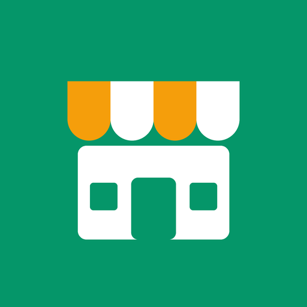

# Boutik

**Le stock, la caisse et le crédit de ta boutique — même sans internet.**

Boutik est un logiciel (SaaS) de gestion pour les **boutiques et commerces d'Afrique de l'Ouest** :
épiceries, boutiques de quartier, quincailleries, demi-grossistes… Il remplace le cahier, la
calculatrice et le carnet de dettes.

**Accéder au site : [https://boutik-services.vercel.app](https://boutik-services.vercel.app)**

15 jours d'essai gratuit, sans engagement.

---

## Le problème

Dans une boutique, on vend le riz au kilo mais on l'achète au sac, on fait crédit aux clients
fidèles, et le réseau internet coupe souvent. Le cahier ne dit pas combien il reste en stock, qui doit
quoi depuis quand, ni si la caisse du soir est juste.

## Fonctionnalités

### Vendre
- **Caisse rapide** : recherche ou code-barres (caméra ou lecteur USB), paiement mixte espèces +
  Mobile Money, monnaie à rendre, remise limitée par vendeur.
- **Factures** PDF envoyées par WhatsApp, **tickets** sur imprimante Bluetooth 58 / 80 mm, impression A4.
- Annulation et retour d'articles, avec retour en stock dans les bons lots.

### Gérer le stock
- **Plusieurs unités** par produit (kilo, sac 25 kg, sac 50 kg, carton…) : « 9 sacs + 47 kg ».
- Réceptions de marchandise, **lots et dates de péremption** (le plus proche sort en premier),
  alertes 30 et 7 jours avant, blocage des périmés.
- Pertes, stock bas, **inventaire** « à l'aveugle ».

### Suivre le crédit et l'argent
- **Carnet de crédit** par client : plafond, remboursements avec reçu, débiteurs classés par
  ancienneté, relance WhatsApp en un clic.
- **Caisse du jour** : fond de caisse, dépenses, clôture du soir avec les écarts.
- **Faire un compte** : bilan complet (ventes, bénéfice réel, dépenses, stock, dettes) depuis le
  compte précédent, archivé.
- **Tableau de bord** et **export Excel**.

### Pour l'équipe
- Plusieurs rôles par personne (gérant, caissier, vendeur, magasinier, compteur), **code PIN**,
  journal de toutes les actions sensibles.

## Hors ligne d'abord

Chaque opération est enregistrée dans l'appareil, tout de suite, puis synchronisée quand le réseau
revient. Plusieurs appareils peuvent vendre en même temps, hors ligne : rien ne se perd.

## Disponible sur

| Plateforme | |
|---|---|
| 🤖 Android | application (APK) |
| 🪟 Windows | logiciel à installer |
| 🐧 Linux | AppImage |
| 🌐 Web | dans le navigateur, installable |
| 🍎 iPhone / Mac | bientôt (en attendant : version web) |

## Tarifs (Bénin)

- 15 jours d'essai gratuit ;
- **10 000 F / mois** les 3 premiers mois ;
- ensuite, selon la moyenne mensuelle des ventes du trimestre précédent :
  **10 000 F** (moins de 1,5 million F), **15 000 F** (de 1,5 à 5 millions F) ou **25 000 F**
  (plus de 5 millions F).

Paiement par MTN MoMo, Moov Money ou Celtiis Cash. Même en retard de paiement, la boutique peut
toujours vendre.

## Contact

- E-mail : ernestjesutinafaton@gmail.com
- WhatsApp : +33 7 74 81 38 96

---

Le code source de Boutik est privé. Ce dépôt sert uniquement à présenter l'application.
